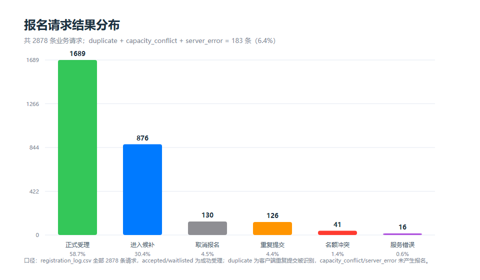
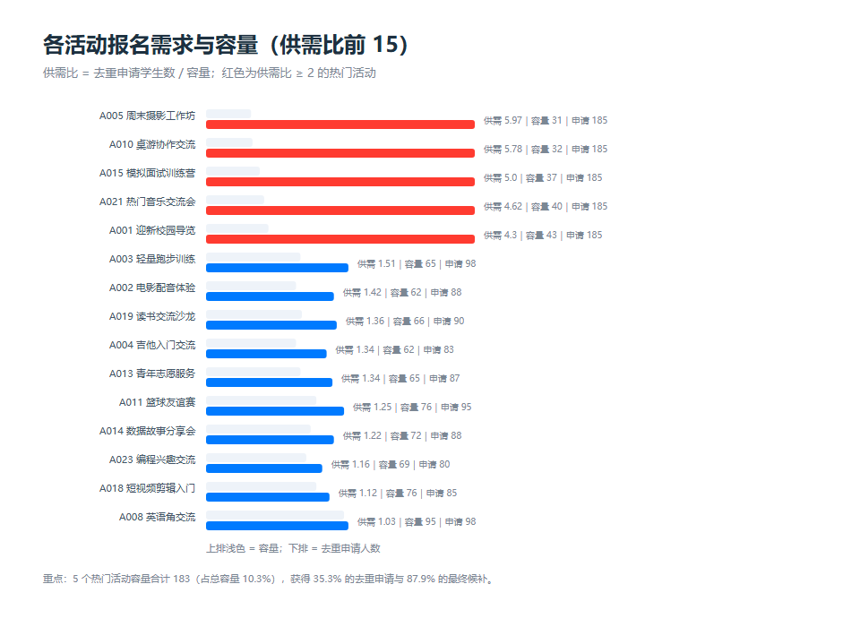
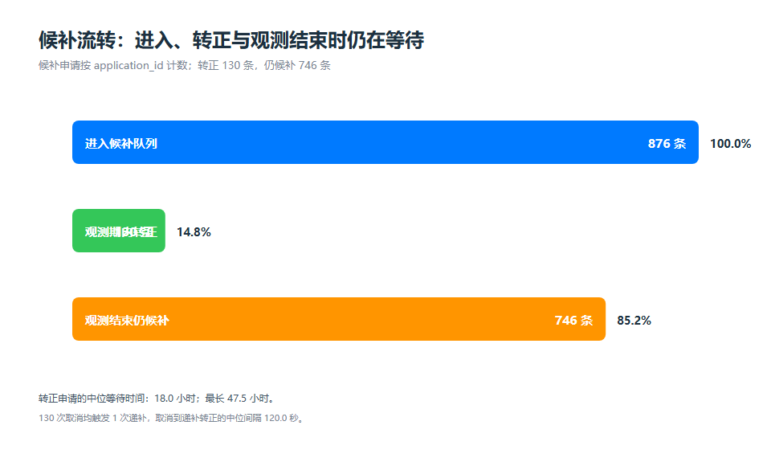
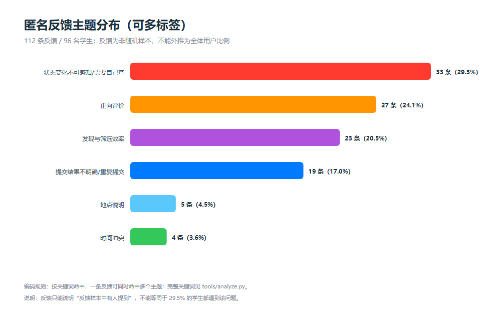
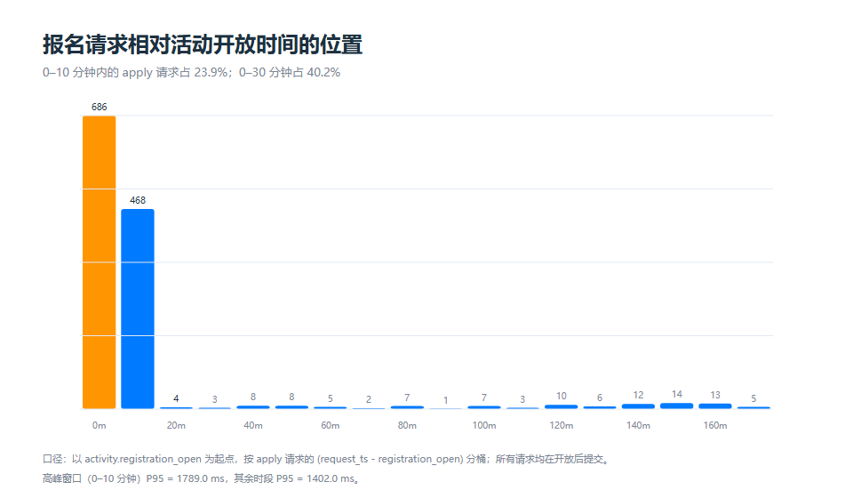
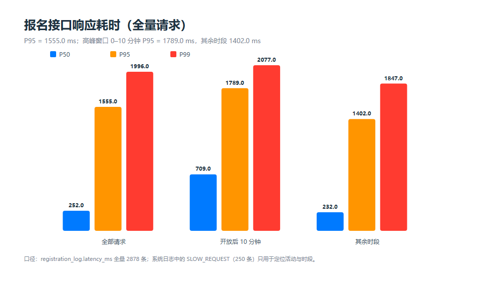
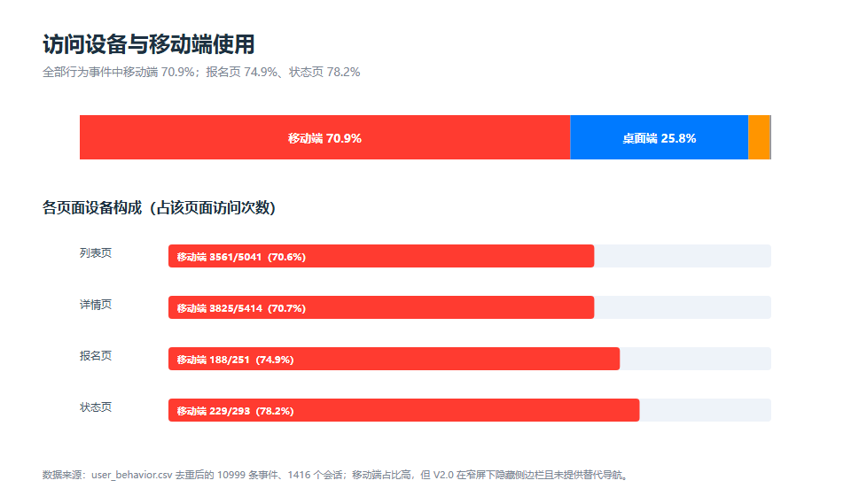
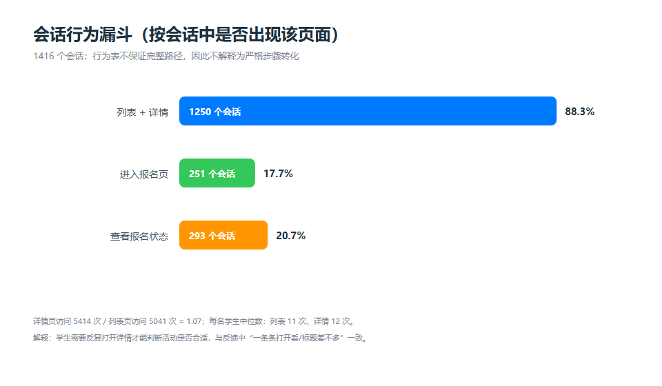
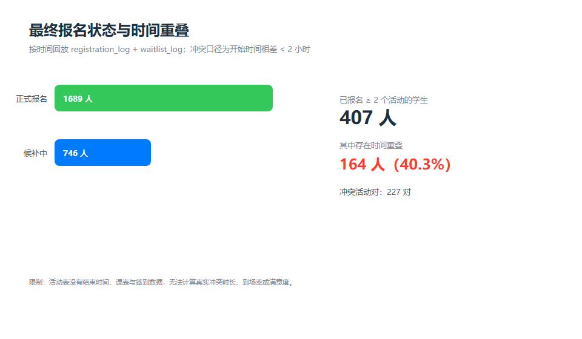

# 实验三 数据分析报告｜基于 V2.0 模拟运行数据的需求发现

> 数据来源：教师提供的 `项目数据/data`（V2.0 平台模拟运行样本，2026-09-21 至 2026-10-07）。
> 分析脚本：`tools/analyze.py`（仅 Python 标准库）；结构化结果：`analysis/summary.json`；可复核表格：`analysis/tables/`；图表：`analysis/figures/`。
> 重要边界：这些数据不是本组 V3.0 系统的实际运行日志，结论只用于判断“哪些问题值得改进”，不能当作 V3.0 的实测效果。

---

## 一、数据与统计口径

### 1.1 数据规模

| 文件 | 行数（不含表头） | 用途 |
|---|---:|---|
| `activity.csv` | 24 | 活动基本信息、容量、报名开放与活动开始时间 |
| `user_behavior.csv` | 11 027 | 页面访问行为；去重后 10 999 行 |
| `registration_log.csv` | 2 878 | 报名/取消业务请求及处理结果、耗时 |
| `waitlist_log.csv` | 1 006 | 候补状态变化（进入候补 876、转正 130） |
| `feedback.csv` | 112 | 匿名反馈原文 |
| `system_log.csv` | 792 | 系统日志（其中 `registration_api` 485 条） |

基础规模：24 个活动、10 个类别，总容量 1 781；报名相关学生 420 人；行为数据覆盖 399 名学生、1 416 个会话。

### 1.2 关键口径（报告中的数字均按此计算）

| 指标 | 定义 |
|---|---|
| 报名请求 | `registration_log.csv` 的一行；同一学生可因重试产生多条请求 |
| 去重申请人数 | 按 `(student_id, activity_id)` 去重；用于供需比，避免重复提交放大需求 |
| 供需比 | 去重申请人数 ÷ 活动容量 |
| 最终状态 | 将 `registration_log` 与 `waitlist_log` 按时间回放后的 `confirmed` / `waitlisted`；不能直接把 `accepted` 条数当最终正式人数 |
| 候补转正率 | 最终转为 `accepted` 的候补申请数 ÷ 进入过 `waiting` 的候补申请数 |
| 高峰窗口 | 活动报名开放后 0–10 分钟内的 `apply` 请求 |
| 反馈主题占比 | 命中某主题的反馈条数 ÷ 112 条反馈；反馈是非随机样本，**不能外推为全体用户比例** |
| 时间冲突 | 同一学生最终正式报名的活动之间，开始时间相差 < 2 小时；缺少结束时间与课表，是代理口径 |

### 1.3 数据质量与处理

- `user_behavior.csv` 存在 **28 行完全重复采集**，按整行去重后为 10 999 行；另有 13 行缺失 `student_id`、22 行缺失 `device`。缺失 `student_id` 的记录仍计入页面访问量，但不进入“按学生”统计。
- `registration_log.csv`、`waitlist_log.csv` 的关键字段无缺失。
- `system_log.csv` 有 307 行没有 `request_id`（通用系统日志），且 `registration_api` 事件只有 485 条，远少于 2 878 条报名请求。因此**系统日志只用于“慢请求/错误事件”的计数与定位，不用来推算全量错误率**；全量耗时以 `registration_log.latency_ms` 为准。
- 反馈是 112 条、来自 96 名学生的非结构化文本，26 种不同表述；没有评分、标签字段。反馈主题由关键词规则编码，一条反馈可命中多个主题。
- 活动表没有活动结束时间、课表、签到与评分数据，所以**无法计算到场率、满意度，也无法量化“与课程冲突”**。

---

## 二、分析结果

### 2.1 报名请求结果：成功、候补与“不确定”并存



2 878 条请求中：`accepted` 1 689 条（58.7%）、`waitlisted` 876 条（30.4%）、`cancelled` 130 条（4.5%）、`duplicate` 126 条（4.4%）、`capacity_conflict` 41 条（1.4%）、`server_error` 16 条（0.6%）。

只看 2 748 条 `apply` 请求：61.5% 直接受理，31.9% 进入候补，4.6% 被判为重复提交，1.5% 名额冲突，0.6% 服务错误。**duplicate + capacity_conflict + server_error 共 183 条，占全部请求的 6.4%**；其中 126 条 `duplicate` 的 `client_retry` 全部为 1，说明确实是客户端再次提交。

> 观察事实：存在一批“学生重复提交、结果不确定”的请求。
> 原因推测：热门活动提交后等待时间长、失败原因提示不够明确，学生倾向于再点一次确认；数据不能直接证明因果。

### 2.2 供需高度集中：5 个热门活动拿走大部分需求



需求最集中的 5 个活动：

| 活动 | 容量 | 去重申请 | 供需比 | 最终候补 |
|---|---:|---:|---:|---:|
| A005 周末摄影工作坊 | 31 | 185 | 5.97 | 134 |
| A010 桌游协作交流 | 32 | 185 | 5.78 | 127 |
| A015 模拟面试训练营 | 37 | 185 | 5.00 | 136 |
| A021 热门音乐交流会 | 40 | 185 | 4.62 | 135 |
| A001 迎新校园导览 | 43 | 185 | 4.30 | 124 |

这 5 个活动只占总容量 **10.3%**，却获得 **35.3% 的去重申请**和 **87.9% 的最终候补**；系统日志中的 250 条 `SLOW_REQUEST` **全部**落在这些活动上。另有 7 个活动供需比 < 1（容量未用满）。

> 观察事实：热门活动容量与需求严重不匹配，慢请求也集中在这些活动。
> 原因推测：活动类型/时间安排集中、宣传集中，导致“抢报”；数据不支持进一步归因。

### 2.3 候补：转正率低、等待长，且观测结束仍有大量积压



- 876 条候补申请中，130 条在观测期内转正，**转正率 14.8%**；观测结束时仍有 **746 条（85.2%）在候补**。
- 转正等待时间：中位 **18.0 小时**，P90 46.3 小时，最长 47.5 小时。
- 130 次取消全部来自“已正式报名”，且每次取消在 **120 秒**内触发 1 次递补；取消率约为曾获正式名额的 7.1%（130 / 1 819）。
- 最终状态：正式报名记录 1 689 条、候补记录 746 条；按时间回放后正式人数不等于 `accepted` 条数（存在取消与递补）。

> 观察事实：候补队列长、转正等待长、观测末仍有大量候补。
> 原因推测：容量不足与取消释放名额少是直接原因；但数据无法区分“学生放弃等待”与“活动尚未开始”。

### 2.4 状态感知：学生只能靠自己反复查

- 20.7% 的会话访问过报名状态页；状态页访问中移动端占 78.2%。
- 反馈样本中 **33/112 条（29.5%）** 提到“候补结果只能自己查”“隔两天才发现转正”“担心错过结果”等；涉及的学生数见 `analysis/tables/feedback_themes.csv`。
- 结合 2.3：130 次转正如果只靠学生自查，很容易错过；746 条仍未转正的候补也需要可追踪的队列位置。



### 2.5 提交确定性与响应耗时

- 报名请求 P50 = 252 ms、P90 = 1 269 ms、**P95 = 1 555 ms**、P99 = 1 996 ms、最大 2 650 ms。
- 开放后 0–10 分钟的高峰窗口有 688 条申请（占 apply 的 25.0%），P95 = **1 789 ms**；其余时段 P95 = 1 402 ms。
- 23.9% 的请求集中在开放后 10 分钟内，40.2% 在 30 分钟内；报名行为高度“开闸即抢”。
- 250 条 `SLOW_REQUEST`（耗时 P50 1 560 ms）全部在 5 个热门活动；日志中另有 41 条 E409、16 条 E500。
- 反馈样本中 **19/112 条（17.0%）** 提到“不确定是否提交成功”“页面卡住又点了一次”“失败原因不清楚”。





> 观察事实：存在 6.4% 的重复/冲突/错误请求，高峰耗时明显高于平时，且反馈中有人明确描述“重复点击”。
> 原因推测：学生看不到明确的提交中/成功/失败回执，是重复提交的重要诱因；但模拟数据不能证明服务端幂等缺失。

### 2.6 移动端已是主入口，但 V2.0 窄屏没有替代导航



- 行为事件中移动端 **70.9%**、桌面端 25.8%、平板 3.1%（22 条未记录设备）。
- 报名页移动端占 **74.9%**（188/251），状态页移动端占 **78.2%**（229/293）。
- 反馈样本中也有“页面在电脑上使用很顺畅”的正向评价，但未提及手机端体验；行为数据说明手机端是主要使用场景。

> 观察事实：移动端占多数，且状态查询更偏向移动端。
> 原因推测：V2.0 在 ≤980px 直接隐藏侧边栏而没有底部导航，手机用户可能只能看到活动广场、无法进入“我的活动/通知中心”。这是代码审计发现的实现问题，需要修复。

### 2.7 发现与筛选：详情页访问多于列表页



- 1 416 个会话中，88.3% 同时出现列表页与详情页，17.7% 进入报名页，20.7% 查看状态页。
- 列表页访问 5 041 次，详情页 5 414 次，**详情/列表 = 1.07**；每名学生中位数：列表 11 次、详情 12 次。
- 反馈样本中 **23/112 条（20.5%）** 提到“标题看着差不多”“要一条条打开看”“想找周末的活动”“只想看一类”。

> 观察事实：学生需要打开大量详情才能判断活动是否合适，筛选/信息展示效率有改进空间。
> 原因推测：列表卡片信息不足、缺少“周末/有无名额”等快捷筛选，可能增加浏览成本；行为表不保证完整会话路径，不能据此计算严格转化率。

### 2.8 时间冲突



- 418 名学生至少有一个正式报名；其中 407 名正式报名 ≥ 2 个活动，**164 名（40.3%）** 存在开始时间相差 < 2 小时的活动，共 227 对。
- 反馈样本中另有 4/112 条提到“活动时间和课程冲突”，但数据包没有课表，无法量化课程冲突，也无法得到真实冲突时长。

> 观察事实：按“开始时间差 < 2 小时”的代理口径，多活动报名者中存在大量时间重叠。
> 原因推测：学生在报名时缺少跨活动的统一时间视图；该口径不等于真实冲突，报告与产品文案都需注明。

### 2.9 正向信号

反馈样本中 27/112 条（24.1%）为正向评价（报名较顺利、记录能查到、信息较齐全、教师发布方便等）。这些评价说明 V2.0 的基础报名、记录查询和教师发布能力应保留，不应为了 V3.0 改坏原有流程。

---

## 三、从数据到 V3.0 需求

| 编号 | 需求 | 主要数据证据 | V3.0 决策 |
|---|---|---|---|
| R1 | 报名状态变化通知与状态时间线 | 876 条候补、130 条转正、746 条仍候补；33/112 条反馈提到状态不可感知；20.7% 会话访问状态页 | 站内通知中心（候补递补/审核结果/关闭审核自动处理/活动下架）+ 状态更新时间 + 未读徽标 |
| R2 | 报名提交的确定性与幂等防重 | 126 条 duplicate（占 apply 4.6%）、41 条 capacity_conflict、16 条 server_error；19/112 条反馈提到重复点击/原因不明；P95 1 555 ms | 前端提交中状态与防重复点击；服务端 request_token 幂等；成功回执；失败原因与重试入口 |
| R3 | 移动端可用性 | 移动端占 70.9%，报名页 74.9%、状态页 78.2%；窄屏隐藏侧边栏 | 移动端底部导航 + 响应式布局 + 全屏详情 |
| R4 | 发现与筛选效率 | 详情/列表 1.07；每生中位数列表 11 次/详情 12 次；23/112 条反馈提到筛选困难 | 仅看有名额/仅看周末/排序；搜索扩展到主办方与介绍；卡片直接显示时间、地点、余量、候补人数 |
| R5 | 供需失衡的教师概览与备选推荐 | 5 个热门活动占 10.3% 容量、35.3% 申请、87.9% 最终候补、100% 慢请求 | 教师端展示申请/正式/候补/待审核与供需比；学生端满员时推荐同类且有余量的活动 |
| R6 | 时间冲突聚合提醒 | 407 名多活动报名者中 164 名（40.3%）存在 < 2 小时重叠，共 227 对 | “我的活动”常驻冲突卡片 + 卡片冲突标记；口径保持 < 2 小时并明确说明 |

**本轮不处理**：高峰期的服务端性能（250 条慢请求、P95 1 789 ms）。它需要排队/限流/扩容等更大的改动，本轮只在报告中记录，不在 V3.0 中声称已解决；前端防重复提交只能减少一部分无效请求，不能证明接口变快。

---

## 四、结论与局限

### 4.1 可以下的结论

1. 报名链路的主要问题不是“报名不可用”，而是**结果不确定、状态变化不可感知、热门活动供需失衡**；这三类问题分别对应提交确定性、通知与教师概览。
2. 行为数据与反馈在“状态查询成本高”“需要反复打开详情”“移动端为主”上互相印证，但两者的总体不可直接合并。
3. V2.0 的基础报名、候补、审核、取消递补、教师发布与管理员治理都有正向反馈，V3.0 应保留这些能力，只做增量改进。

### 4.2 不能下的结论

- 不能把 112 条反馈的 29.5% 当成“全体学生中 29.5% 遇到状态问题”；它只是反馈样本中的条数比例，96 名学生也远小于 420 名报名学生。
- 不能用 250 条慢请求除以 485 条日志算“51.5% 请求慢”；日志不是全量，全量耗时以 `registration_log` 为准。
- 不能用 `accepted` 条数当最终正式人数；存在 130 次取消与 130 次递补。
- 不能计算到场率/满意度；数据没有签到和评分字段。上一版分析中的“候补递补到场率 47.6%”“反馈标签 44.2%”“冲突 25.9%”等数字来自另一份自造数据，**已全部废弃**。
- 不能把教师提供的模拟数据当成 V3.0 的实际测试结果；V3.0 的功能验证见实验报告第五章，效果验证只做到“功能可用/原有功能未回归”，没有做真实用户前后对比。

---

## 五、复现方式

```bash
# 1. 统计与图表（无需 pandas/matplotlib）
python tools/analyze.py

# 2. 可选：把 SVG 图表渲染为 PNG（需要本机 Edge/Chrome）
python tools/render_figures.py
```

输出：

- `analysis/summary.json`：全部指标、口径、需求映射、局限
- `analysis/tables/activity_demand.csv`：每活动供需、结果、候补、慢请求
- `analysis/tables/feedback_themes.csv`：反馈主题计数与关键词
- `analysis/tables/funnel.csv`、`latency.csv`、`conflict_pairs.csv`、`waitlist_promotions.csv`
- `analysis/figures/fig1~fig9`：报告图表（SVG 与 PNG）
